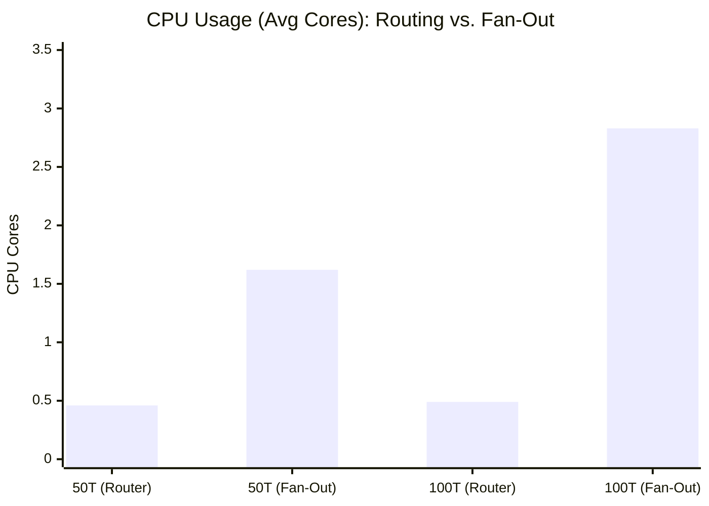
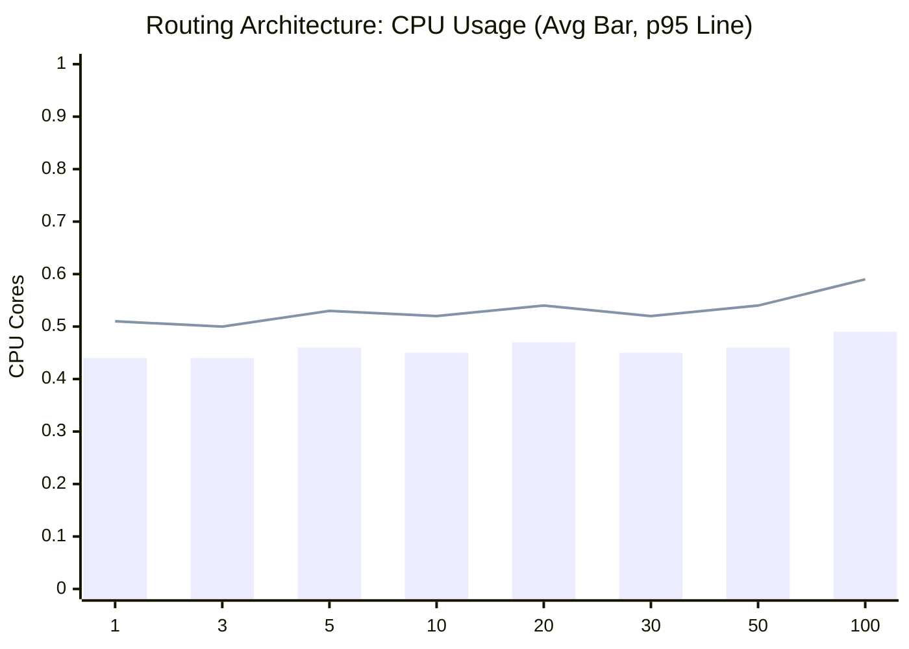
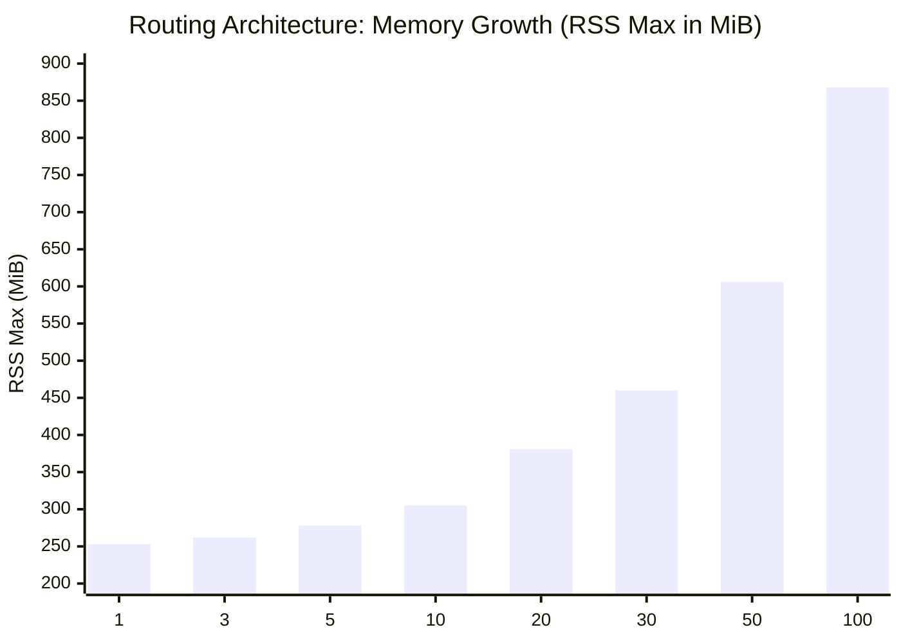

# Lifting the Pipeline limit

Currently the kyma telemtry manager has a pipeline limit of 5 pipelines per signal.
For mutli-tenant use-cases this is bad.
So what is accually stopping the telemetry manager from removing this manual limit?

## Limitations & Questions

The pipeline limit is protection against extrem resource usage, and other kubernetes limitations. So these questions need to be ansewred:

- With many pipelines the configmap size would grow, how do can we overcome the 1MiB config map size limit from kubernetes?
- How performant is it to use the same otel collector instance for mutli-tenant application?
- Do all pipelines need 100% of raw signals or could they also only receive the subset they accually need already enriched by a unified pipeline?

## Answers

### [x] Configmap Size Limit

Luckly the OpenTelmetry Collector already supports config-file splitting. This allows us to split the main config into multiple config maps, that will be asampled into a single configuration on otel-col startup.
Telemetry Manager needs to decide how it wants to split its configuration, for example configs could be split into expoters, processors, pipelines etc. or just based on a size limit, i.e. if a config map reaches 80% of the limit => split into two sperate configmaps.

Reaching the config map limit of 1MiB is highly unlikely for most clusters, but if it uses a highly customised pipeline strucutre with many pipelines this limit can be reached.

### [x] Performance

OpenTelmetry collector is increadibly performant. Though with more processors there is a performance penality. Below you can find the performance benchmarks. There is of course a huge performance/resource penality. When scaling from one pipelines(tennat) to 100 pipelines(tennants), the resource usage increased by almost 10x.

### [x] Unified Routing Pipeline

A unified routing pipeline approch is highly recommended.
In our example we used a routing pipeline using the routing processor.
The routing pipeline can be used to already handle k8s_attribute enrichment, and then routing based on the namespace.
This ensures that the other pipelines only receive the data they are interested and centerlising global processors.

A simple fan-out principle can also be used. But as shown in our load tests this leads to a substanial higher resource usage. Also if used in a multi-tenant scenario everyone could read each others data. The problem with a simple fan-out is dublicated processor instances, which leads to high CPU overhead, where as the memory stays rather similar to a routing approch.

The trade-off is one extra connector hop, which ADR 013's tests showed costs basically nothing.

## Benchmarks

To evaluate how the OpenTelemetry Collector handles high pipeline counts, we conducted load and resilience benchmarks. While modeled around a multi-tenant setup, allocating three pipelines per tenant (one per telemetry signal), the findings apply equally to any cluster running a large number of pipelines.

Rather than pushing for saturation limits, our primary benchmarks measure resource consumption under realistic throughput (10k spans/s, 9k metrics/s, and 6k logs/s per node). We compared a native `fan-out` architecture against an optimized `routing` approach.

Beyond standard throughput, failure scenarios test resilience by blocking a single tenant's backend across all three of its pipelines, verifying how the collector responds and ensuring neighboring tenants remain unaffected.

### Benchmark Setup

All tests ran on a GCP Gardener shoot, isolating components into dedicated node pools to prevent interference:

- **Load generators:** `n4-highcpu-8` (handling CPU-intensive traffic generation)
- **OTel Collector:** `n1-standard-4`
- **Supporting infrastructure:** `n1-standard-4`

Source code and deployment manifests reside in [`./load-test`](./load-test).

Execution is driven by a benchmark job that first deploys a fresh OTel Collector alongside three storage backends. Once healthy, three load-generator pods spin up (one per signal type). Under the hood, each pod runs OpenTelemetry's `telemetrygen` in a custom image with shell access, launching a dedicated process per tenant on startup.

Custom collector pipelines are configured accordingly for every tenant and signal type. After each test run and a cooldown window, the benchmark job queries VictoriaMetrics (or any Prometheus-compatible backend) to gather metrics.

Below is an architectural overview of this test setup:

### Performance Results

Both configurations were tested under a constant steady-state load of **25k signals/s** (6,000 logs/s, 9,000 metrics/s, and 10,000 traces/s) across a 10-minute window on an `n1-standard-4` node.

#### 1. Routing vs. Fan-Out Comparison

Comparing the two architectures at 50 and 100 tenants demonstrates the massive CPU efficiency gained by centralizing global processors:

| Architecture | Tenants | Pipelines | CPU avg | CPU p95 | RSS max   | Valid Throughput |
| ------------ | ------- | --------- | ------- | ------- | --------- | ---------------- |
| **Routing**  | 50      | 153       | 0.46    | 0.54    | 606 MiB   | 100% (0 drops)   |
| **Fan-Out**  | 50      | 150       | 1.62    | 1.82    | 676 MiB   | 100% (0 drops)   |
| **Routing**  | 100     | 303       | 0.49    | 0.59    | 868 MiB   | 100% (0 drops)   |
| **Fan-Out**  | 100     | 300       | 2.83    | 3.35    | 1 066 MiB | ~7–8% dropped ⚠  |

#### 2. Routing Pipeline Scaling (1 to 100 Tenants)

Using unified routing pipelines, CPU consumption remains almost flat while memory scales predictably with tenants:

| Tenants | Pipelines | CPU avg | CPU p95 | RSS max | Working Set max | Config Size |
| ------- | --------- | ------- | ------- | ------- | --------------- | ----------- |
| 1       | 6         | 0.44    | 0.51    | 253 MiB | 116 MiB         | 3.5 KiB     |
| 3       | 12        | 0.44    | 0.50    | 262 MiB | 131 MiB         | 7.3 KiB     |
| 5       | 18        | 0.46    | 0.53    | 278 MiB | 145 MiB         | 11.2 KiB    |
| 10      | 33        | 0.45    | 0.52    | 305 MiB | 194 MiB         | 20.8 KiB    |
| 20      | 63        | 0.47    | 0.54    | 381 MiB | 268 MiB         | 40.1 KiB    |
| 30      | 93        | 0.45    | 0.52    | 460 MiB | 369 MiB         | 59.2 KiB    |
| 50      | 153       | 0.46    | 0.54    | 606 MiB | 550 MiB         | 97.6 KiB    |
| 100     | 303       | 0.49    | 0.59    | 868 MiB | 1 031 MiB       | 193.7 KiB   |

#### Key Takeaways

- **CPU stays constant with routing**: Centralizing `k8s_attributes` enrichment in an initial pipeline prevents duplicate work, keeping CPU usage around ~0.49 cores even at 100 tenants (303 pipelines).
- **Fan-out suffers from processor duplication**: Duplicating processors across every pipeline instantiated 900 processor instances at 100 tenants, pushing CPU usage to 2.83 cores (~6x higher) and causing queue saturation and message drops.
- **Config size scales linearly**: Reaching ~194 KiB at 100 tenants, remaining well below Kubernetes' 1 MiB ConfigMap boundary.

### Failure Results
