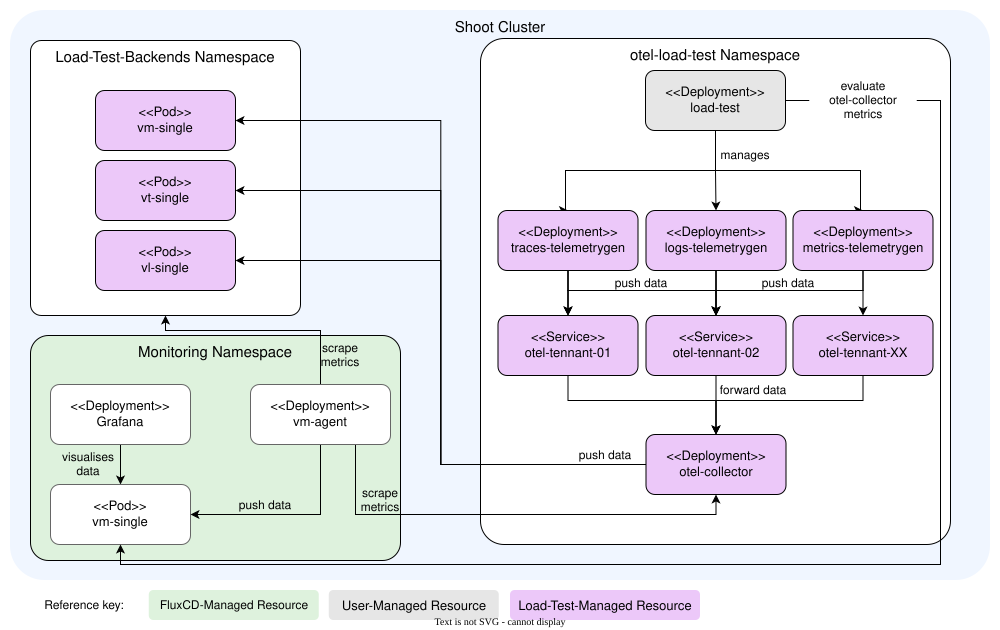
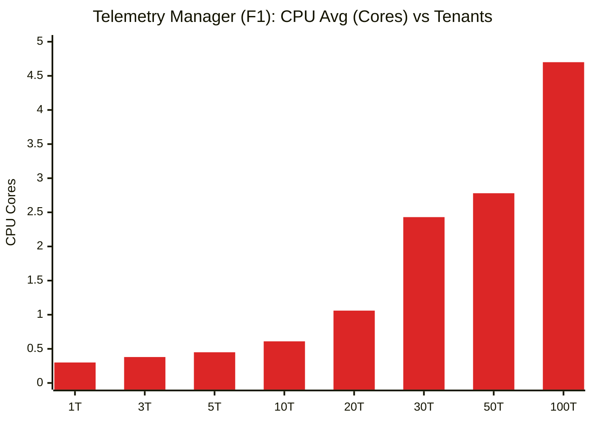
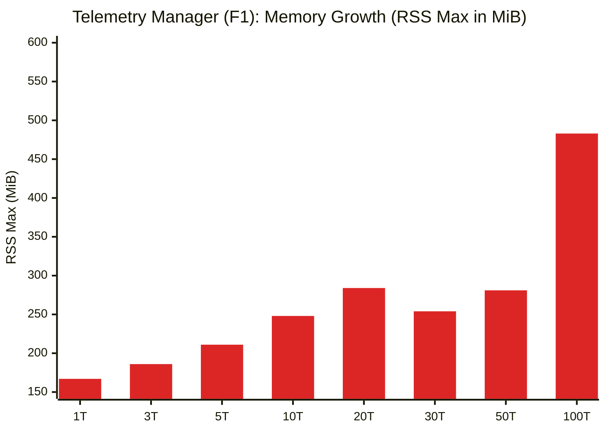
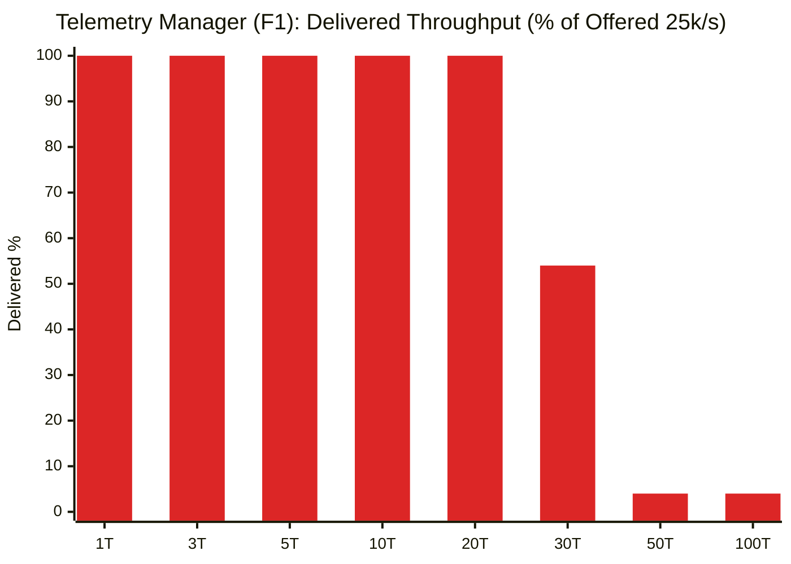

# Lifting the Pipeline limit

Currently the kyma telemtry manager has a pipeline limit of 5 pipelines per signal.
For mutli-tenant use-cases this is bad.
So what is accually stopping the telemetry manager from removing this manual limit?

## Limitations & Questions

The pipeline limit is protection against extrem resource usage, and other kubernetes limitations. So these questions need to be ansewred:

- With many pipelines the configmap size would grow, how do can we overcome the 1MiB config map size limit from kubernetes?
- How performant is it to use the same otel collector instance for mutli-tenant application?
- Do all pipelines need 100% of raw signals or could they also only receive the subset they accually need already enriched by a unified pipeline?

## Answers

### [x] Configmap Size Limit

Luckly the OpenTelmetry Collector already supports config-file splitting. This allows us to split the main config into multiple config maps, that will be asampled into a single configuration on otel-col startup.
Telemetry Manager needs to decide how it wants to split its configuration, for example configs could be split into expoters, processors, pipelines etc. or just based on a size limit, i.e. if a config map reaches 80% of the limit => split into two sperate configmaps.

Reaching the config map limit of 1MiB is highly unlikely for most clusters, but if it uses a highly customised pipeline strucutre with many pipelines this limit can be reached.

### [x] Performance

OpenTelmetry collector is increadibly performant. Though with more processors there is a performance penality. Below you can find the performance benchmarks. There is of course a huge performance/resource penality. When scaling from one pipelines(tennat) to 100 pipelines(tennants), the resource usage increased by almost 10x.

### [x] Unified Routing Pipeline

A unified routing pipeline approch is highly recommended.
In our example we used a routing pipeline using the routing processor.
The routing pipeline can be used to already handle k8s_attribute enrichment, and then routing based on the namespace.
This ensures that the other pipelines only receive the data they are interested and centerlising global processors.

A simple fan-out principle can also be used. But as shown in our load tests this leads to a substanial higher resource usage. Also if used in a multi-tenant scenario everyone could read each others data. The problem with a simple fan-out is dublicated processor instances, which leads to high CPU overhead, where as the memory stays rather similar to a routing approch.

The trade-off is one extra connector hop, which ADR 013's tests showed costs basically nothing.

## Benchmarks

To evaluate how the OpenTelemetry Collector handles high pipeline counts, we conducted load and resilience benchmarks. While modeled around a multi-tenant setup, allocating three pipelines per tenant (one per telemetry signal), the findings apply equally to any cluster running a large number of pipelines.

Rather than pushing for saturation limits, our primary benchmarks measure resource consumption under realistic throughput (10k spans/s, 9k metrics/s, and 6k logs/s per node). We compared a native `fan-out` architecture against an optimized `routing` approach.

Beyond standard throughput, failure scenarios test resilience by blocking a single tenant's backend across all three of its pipelines, verifying how the collector responds and ensuring neighboring tenants remain unaffected.

### Benchmark Setup

All tests ran on a GCP Gardener shoot, isolating components into dedicated node pools to prevent interference:

- **Load generators:** `n4-highcpu-8` (handling CPU-intensive traffic generation)
- **OTel Collector:** `n1-standard-4`
- **Supporting infrastructure:** `n1-standard-4`

Source code and deployment manifests reside in [`./load-test`](./load-test).

Execution is driven by a benchmark job that first deploys a fresh OTel Collector alongside three storage backends. Once healthy, three load-generator pods spin up (one per signal type). Under the hood, each pod runs OpenTelemetry's `telemetrygen` in a custom image with shell access, launching a dedicated process per tenant on startup.

Custom collector pipelines are configured accordingly for every tenant and signal type. After each test run and a cooldown window, the benchmark job queries VictoriaMetrics (or any Prometheus-compatible backend) to gather metrics.

Below is an architectural overview of this test setup:

### Performance Results: Baseline Setup (Minimal Processing)

Both configurations were tested under a constant steady-state load of **25k signals/s** (6,000 logs/s, 9,000 metrics/s, and 10,000 traces/s) across a 10-minute window on an `n1-standard-4` node without heavy transformations. While Routing was evaluated across all tiers from 1 to 100 tenants, Fan-Out was benchmarked at scale (50 and 100 tenants):

| Tenants | Architecture | Pipelines | CPU avg | CPU p95 | RSS max | Working Set max | Config Size | Valid Throughput |
|---|---|---|---|---|---|---|---|---|
| 1 | **Routing** | 6 | 0.44 | 0.51 | 253 MiB | 116 MiB | 3.5 KiB | 100% (0 drops) |
| 3 | **Routing** | 12 | 0.44 | 0.50 | 262 MiB | 131 MiB | 7.3 KiB | 100% (0 drops) |
| 5 | **Routing** | 18 | 0.46 | 0.53 | 278 MiB | 145 MiB | 11.2 KiB | 100% (0 drops) |
| 10 | **Routing** | 33 | 0.45 | 0.52 | 305 MiB | 194 MiB | 20.8 KiB | 100% (0 drops) |
| 20 | **Routing** | 63 | 0.47 | 0.54 | 381 MiB | 268 MiB | 40.1 KiB | 100% (0 drops) |
| 30 | **Routing** | 93 | 0.45 | 0.52 | 460 MiB | 369 MiB | 59.2 KiB | 100% (0 drops) |
| 50 | **Routing** | 153 | 0.46 | 0.54 | 606 MiB | 550 MiB | 97.6 KiB | 100% (0 drops) |
| 50 | **Fan-Out** | 150 | 1.62 | 1.82 | 676 MiB | 704 MiB | 103.9 KiB | 100% (0 drops) |
| 100 | **Routing** | 303 | 0.49 | 0.59 | 868 MiB | 1 031 MiB | 193.7 KiB | 100% (0 drops) |
| 100 | **Fan-Out** | 300 | 2.83 | 3.35 | 1 066 MiB | 1 164 MiB | 206.8 KiB | ~7–8% dropped ⚠ |

```mermaid
---
config:
  themeVariables:
    xyChart:
      plotColorPalette: "#dc2626, #16a34a"
---
xychart-beta
    title "Baseline CPU Usage (Avg Cores): Fan-Out vs. Routing"
    x-axis ["1T", "3T", "5T", "10T", "20T", "30T", "50T", "100T"]
    y-axis "CPU Cores" 0 --> 3.5
    bar "Fan-Out" [0, 0, 0, 0, 0, 0, 1.62, 2.83]
    bar "Routing" [0.44, 0.44, 0.46, 0.45, 0.47, 0.45, 0.46, 0.49]
```

```mermaid
---
config:
  themeVariables:
    xyChart:
      plotColorPalette: "#dc2626, #16a34a"
---
xychart-beta
    title "Baseline Memory (RSS Max MiB): Fan-Out vs. Routing"
    x-axis ["1T", "3T", "5T", "10T", "20T", "30T", "50T", "100T"]
    y-axis "RSS Max (MiB)" 200 --> 1200
    bar "Fan-Out" [0, 0, 0, 0, 0, 0, 676, 1066]
    bar "Routing" [253, 262, 278, 305, 381, 460, 606, 868]
```

*(Note: Fan-Out baseline tests were executed only at 50 and 100 tenants).*

#### Key Takeaways (Baseline)

- **CPU stays constant with routing**: Centralizing `k8s_attributes` enrichment in an initial pipeline prevents duplicate work, keeping CPU usage around ~0.49 cores even at 100 tenants (303 pipelines).
- **Fan-out suffers from processor duplication**: Duplicating processors across every pipeline instantiated 900 processor instances at 100 tenants, pushing CPU usage to 2.83 cores (~6x higher) and causing queue saturation and message drops.
- **Config size scales linearly**: Reaching ~194 KiB at 100 tenants, remaining well below Kubernetes' 1 MiB ConfigMap boundary.

### Performance Results: Production Setup (With Transforms & Enrichments)

To evaluate real-world production overhead, tests were repeated with full Telemetry Manager gateway processing enabled (`k8s_attributes` enrichment and OTTL `transform` processors across all tenant pipelines) under identical 25k signals/s traffic on an `n1-standard-4` node.

#### 1. Architecture Comparison with Transforms

Activating transformations highlights the stark contrast between architectures: Routing comfortably absorbs the extra processing, whereas Fan-Out saturates node CPU and drops nearly half of incoming signals:

| Architecture | Tenants | Pipelines | Processor Instances | CPU avg | CPU p95 | RSS max | Valid Throughput |
|---|---|---|---|---|---|---|---|
| **Routing** | 1 | 6 | 18 | 0.54 | 0.65 | 271 MiB | 100% (0 drops) |
| **Fan-Out** | 1 | 4 | 18 | 0.56 | 0.62 | 279 MiB | 100% (0 drops) |
| **Routing** | 10 | 33 | 45 | 0.58 | 0.67 | 324 MiB | 100% (0 drops) |
| **Fan-Out** | 10 | 31 | 144 | 0.92 | 1.13 | 370 MiB | 100% (0 drops) |
| **Routing** | 20 | 63 | 75 | 0.62 | 0.75 | 384 MiB | 100% (0 drops) |
| **Fan-Out** | 20 | 61 | 284 | 1.30 | 1.48 | 488 MiB | 100% (0 drops) |
| **Routing** | 50 | 153 | 165 | 0.58 | 0.70 | 584 MiB | 100% (0 drops) |
| **Fan-Out** | 50 | 151 | 704 | 2.47 | 2.97 | 922 MiB | Degraded (~5% drops) |
| **Routing** | 100 | 303 | 315 | 0.64 | 0.77 | 972 MiB | 100% (0 drops) |
| **Fan-Out** | 100 | 301 | 1 404 | 3.47 | 3.98 | 1 878 MiB | **Severe drop** (41% logs, 47% metrics) ⚠ |

```mermaid
---
config:
  themeVariables:
    xyChart:
      plotColorPalette: "#dc2626, #16a34a"
---
xychart-beta
    title "CPU Usage (Avg Cores) with Transforms: Routing vs. Fan-Out"
    x-axis ["1T", "10T", "20T", "50T", "100T"]
    y-axis "CPU Cores" 0 --> 4
    bar "Fan-Out" [0.56, 0.92, 1.30, 2.47, 3.47]
    bar "Routing" [0.54, 0.58, 0.62, 0.58, 0.64]
    
```

```mermaid
---
config:
  themeVariables:
    xyChart:
      plotColorPalette: "#dc2626, #16a34a"
---
xychart-beta
    title "Memory (RSS Max MiB) with Transforms: Routing vs. Fan-Out"
    x-axis ["1T", "10T", "20T", "50T", "100T"]
    y-axis "RSS Max (MiB)" 200 --> 2000
    bar "Fan-Out" [279, 370, 488, 922, 1878]
    bar "Routing" [271, 324, 384, 584, 972]

```

#### Key Takeaways (Transforms)

- **Routing handles transformations with negligible scaling penalty**: Transform processing increases baseline CPU by only ~0.10–0.15 cores. As tenant counts scale from 1 to 100, average CPU remains below 0.64 cores (p95 0.77 cores) with zero dropped telemetry.
- **Fan-out causes severe node saturation and data loss**: Duplicating transform processors spawns 1,404 processor instances at 100 tenants. Average CPU shoots to 3.47 cores (p95 3.98 cores, reaching 100% of node capacity), internal queues fill up completely (`queue_util_max 1.0`), and the collector drops 41% of logs and 47% of metrics.
- **Memory stays contained in Routing**: Centralized routing caps peak RSS memory at 972 MiB at 100 tenants, compared to 1,878 MiB in Fan-Out.

### Performance Results: Current Telemetry Manager Implementation (Target: tm)

To assess how Kyma's current Telemetry Manager behaves if the 5-pipeline limit is lifted without architectural changes, load tests targeted the live Telemetry Manager-managed collector (`target: tm`, Fan-Out Shape `F1`) under standard 25k signals/s traffic (6,000 logs/s, 9,000 metrics/s, and 10,000 traces/s) across 10-minute steady-state runs on an `n1-standard-4` node:

| Tenants | Logs rx/s | Metrics rx/s | Traces rx/s | Refused Requests | CPU avg | CPU p95 | RSS max | Status |
|---|---|---|---|---|---|---|---|---|
| 1 | 5 994 | 8 992 | 9 992 | 0 | 0.30 | 0.37 | 167 MiB | 100% (Valid ✓) |
| 3 | 5 993 | 8 995 | 9 994 | 0 | 0.38 | 0.46 | 186 MiB | 100% (Valid ✓) |
| 5 | 5 996 | 8 997 | 9 994 | 0 | 0.45 | 0.51 | 211 MiB | 100% (Valid ✓) |
| 10 | 5 998 | 8 997 | 9 993 | 0 | 0.61 | 0.72 | 248 MiB | 100% (Valid ✓) |
| 20 | 5 977 | 8 961 | 9 978 | 0 | 1.06 | 1.27 | 284 MiB | 100% (Valid ✓) |
| 30 | 1 872 | 2 801 | 8 719 | 742 513 ⚠ | 2.43 | 2.71 | 254 MiB | Degraded (~31% logs/metrics) ✗ |
| 50 | 74 | 138 | 718 | 1 577 204 ⚠ | 2.78 | 3.19 | 281 MiB | **Severe drop** (<2% logs/metrics) ✗ |
| 100 | 153 | 256 | 513 | 2 989 680 ⚠ | 4.70 | 5.69 | 483 MiB | **Complete collapse** (>2.9M refused) ✗ |

#### Key Takeaways (Current Telemetry Manager)

- **Manageable up to 20 tenants**: Between 1 and 20 tenants, the manager sustains 100% throughput with CPU usage scaling progressively from 0.30 to 1.06 cores and memory from 167 to 284 MiB.
- **Cliff at 30 tenants**: Beyond 20 tenants, duplicated pipeline processing causes connection refusals and queue starvation, dropping throughput to ~31% and triggering hard limit `H4`.
- **Complete breakdown at scale**: At 50 and 100 tenants, the collector is overwhelmed with millions of refused requests, driving CPU consumption to 4.70 cores avg (5.69 cores p95, heavily throttled on a 3.92 core node) and delivering less than 3% of telemetry. This confirms that lifting the pipeline limit requires shifting to the unified routing architecture.

### Failure & Tenant Isolation Results

To evaluate resilience against "noisy neighbor" failures and backpressure, fault-injection tests targeted pipeline `p-000` across all three signal types. The faulty backend returned **70% HTTP 503 errors** with artificial delays (1,000ms delay on both 503 and 200 responses) under continuous 25k signals/s traffic with full gateway transformations enabled.

Detailed raw reports are available in [`results-transforms-routing-faulty.md`](./load-test/results/results-transforms-routing-faulty.md) and [`results-transforms-fan-out-faulty.md`](./load-test/results/results-transforms-fan-out-faulty.md).

#### 1. Tenant Isolation Under Downstream Outage

Testing verified whether a failing backend causes head-of-line blocking or backpressure that spills into neighboring healthy tenants:

| Tenants | Architecture | Healthy Delivered (Logs · Metrics · Traces) | Faulty `p-000` Exported/s | Send Failures | Enqueue Failures | Queue Util Max | CPU avg (p95) |
|---|---|---|---|---|---|---|---|
| 2 | **Routing** | 100% · 100% · 100% | 167 · 149 · 150 | 0 | 0 | 0.8% | 0.50 (0.57) |
| 2 | **Fan-Out** | 100% · 100% · 100% | 165 · 143 · 158 | 0 | 0 | 0.8% | 0.56 (0.63) |
| 20 | **Routing** | 99.9% · 100% · 99.9% | 148 · 148 · 157 | 0 | 0 | 8.3% | 0.64 (0.78) |
| 20 | **Fan-Out** | 100% · 99.9% · 100% | 144 · 160 · 143 | 0 | 0 | 8.3% | 1.36 (1.62) |
| 50 | **Routing** | 100% · 99.9% · 99.8% | 55 · 58 · 68 | 0 | 0 | 20.0% | 0.61 (0.69) |
| 50 | **Fan-Out** | 99.8% · 100% · 99.8% | 62 · 47 · 62 | 0 | 0 | 20.0% | 2.68 (3.23) |

```mermaid
---
config:
  themeVariables:
    xyChart:
      plotColorPalette: "#dc2626, #16a34a"
---
xychart-beta
    title "CPU Avg (Cores) During Backend Fault: Fan-Out vs. Routing"
    x-axis ["2T", "20T", "50T"]
    y-axis "CPU Cores" 0 --> 3.5
    bar "Fan-Out" [0.56, 1.36, 2.68]
    bar "Routing" [0.50, 0.64, 0.61]
```

#### Key Takeaways (Fault Isolation)

- **Dedicated exporter queues isolate failing tenants**: In both architectures, the internal exporter queue for `p-000` isolated the retry backoff and 503 delays without blocking global pipelines. Maximum queue utilization peaked at 20% on the faulty pipeline, causing zero enqueue or send errors for healthy tenants.
- **Healthy tenant throughput remained at 100%**: Unaffected tenants experienced zero dropped signals or degraded throughput despite the persistent outage on tenant `p-000`.
- **Routing shields against resource spikes during outages**: Routing CPU consumption remained completely stable at ~0.61 cores at 50 tenants. While Fan-Out also isolated tenant queues successfully, its duplicated processors still incurred high CPU overhead (2.68 cores avg / 3.23 cores p95).
