# Lifting the Pipeline Limit: Results

**OTel pipeline scalability research for Telemetry Manager (TM)** · Tom Ludwig, Louis Kauer · October 2026

Raw data per run: [`load-test/results/`](load-test/results) · tooling: [`load-test/tooling/`](load-test/tooling) · test plan: [`docs/test-plan-phase-1.md`](docs/test-plan-phase-1.md)

## Summary

| Question                                                                    | Answer                                                                                                                                                                   |
| --------------------------------------------------------------------------- | ------------------------------------------------------------------------------------------------------------------------------------------------------------------------ |
| **Q1 ConfigMap size:** do generated configs stay below 1 MiB?               | **Yes.** At 100 tenants the worst OTLP-only config is 226 KiB (22 %), the TM log agent 589 KiB (57 %). The log agent would reach 1 MiB first, at about 175 tenants.      |
| **Q2 Performance:** how does one collector cope with hundreds of pipelines? | **Routing stays flat, Fan-Out does not.** Routing: 0.54 → 0.64 cores from 1 to 100 tenants, zero drops. Fan-Out (today's TM shape): 0.56 → 3.47 cores.                   |
| **Q3 Architecture:** do all pipelines need all raw signals?                 | **No.** Enrich once, then route each item to its tenant pipeline. The log agent needs the same fix: today every LogPipeline reads and parses every log line on the node. |

**Recommendation:** raise the limit now to **20 TracePipelines / MetricPipelines** and **10 LogPipelines**; target **100** after routing is in TM ([details](#10-conclusion-and-next-steps)).

## Contents

1. [Context](#1-context)
2. [Load test design](#2-load-test-design)
3. [TM gateway results](#3-tm-gateway-results)
4. [Fan-Out vs. Routing](#4-fan-out-vs-routing)
5. [TM full stack](#5-tm-full-stack)
6. [Log agent scalability](#6-log-agent-scalability)
7. [ConfigMap size](#7-configmap-size)
8. [Fault isolation](#8-fault-isolation)
9. [Persistent queues](#9-persistent-queues)
10. [Conclusion and next steps](#10-conclusion-and-next-steps)

---

## 1. Context

Epic: [kyma-project/telemetry-manager#3900](https://github.com/kyma-project/telemetry-manager/issues/3900)

TM allows at most **5 pipelines per signal type** (LogPipeline, MetricPipeline, TracePipeline). The limit protects the cluster from runaway resource usage, but it blocks multi-tenant setups that need one pipeline set per tenant. The epic asks for measurements from 1 to 100 pipelines per signal (OTel components only, no Fluent Bit), a report on resource footprint, buffers, config size and Kubernetes limits, and a data-backed limit recommendation.

## 2. Load test design

### What "1 tenant" means

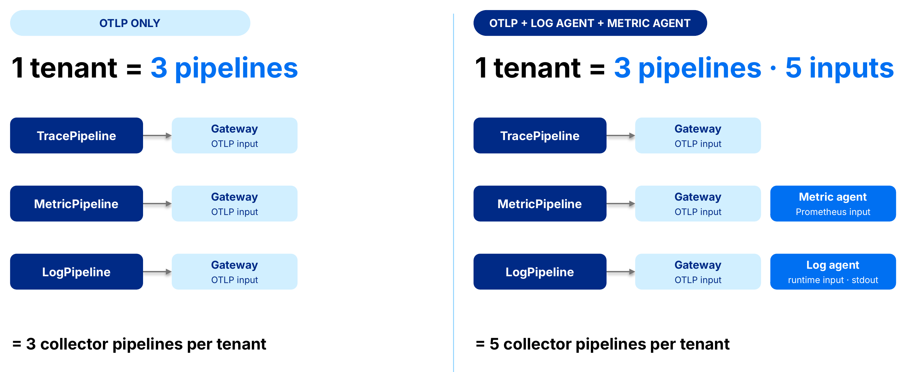

- **OTLP only:** 1 tenant = 1 TracePipeline + 1 MetricPipeline + 1 LogPipeline = 3 collector pipelines, all in the gateway.
- **Full stack:** the same 3 TM pipelines, but MetricPipeline also has the Prometheus input (metric agent) and LogPipeline the runtime input (log agent, container stdout) = 5 collector pipelines.
- Every pipeline keeps only its own tenant's data (OTTL filter on the `tenant` attribute).

### Setup

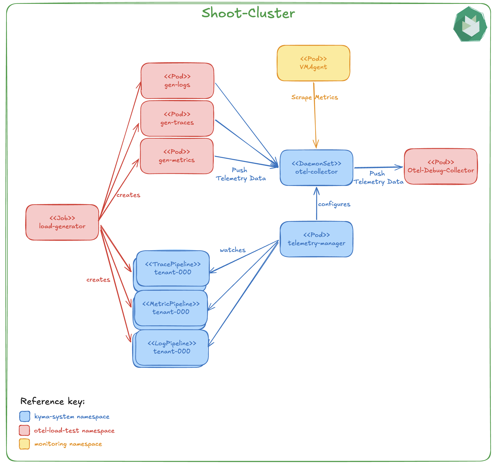

A load-test Job in the cluster deploys the pipelines, starts one generator pod per signal and one process per tenant, waits for warm-up, measures the steady state through the self-monitoring VictoriaMetrics (`vm-single`) and writes one JSON result line per run.

|                           | Value                                                                                                                                                                                                                                                 |
| ------------------------- | ----------------------------------------------------------------------------------------------------------------------------------------------------------------------------------------------------------------------------------------------------- |
| Cluster                   | GCP Gardener shoot `berlin`, `europe-west-1`, managed by Flux                                                                                                                                                                                         |
| Load                      | **25,000 signals/s in total** (6k logs, 9k metric points, 10k spans), split evenly across tenants; log body 2,000 bytes                                                                                                                               |
| Full-stack load split     | gateway: 10k spans, 2k metric points, 3k logs · metric agent: 7k points (avalanche, 30 s scrape) · log agent: 3k lines/s (stdout generator)                                                                                                           |
| Tenant tiers              | 1, 3, 5, 10, 20, 30, 50, 100                                                                                                                                                                                                                          |
| Phases                    | 2 min warm-up, **10 min steady state (measured)**, 1-2 min cool-down; one run per tier                                                                                                                                                                |
| Generators                | telemetrygen v0.163.0 (OTLP), stdout-log-generator, avalanche v0.7.0                                                                                                                                                                                  |
| Plain OTel Collector      | `otel/opentelemetry-collector-contrib:0.161.0` on a dedicated, tainted `n1-standard-4` node (3.92 CPU, 13.5 GiB); 4 Gi memory limit, no CPU limit; generators on separate load nodes (`n1-standard-4`, `n2-highcpu-8`, `n4-highcpu-8`)                |
| TM                        | Helm chart 1.74.1 with the pipeline limit lifted, VPA on. Gateway runs on an `n4-highcpu-16` node. Full stack: everything on one `n4-highcpu-32` (31.9 CPU, 61.7 GiB), image `1.74.1-loadtest-mem` (gateway limit 2 GiB, agents 3 GiB)                |
| Collector config          | copied from the TM gateway structure. It keeps all transforms and filters so the results are comparable to TM                                                                                                                                         |
| Enrichment ("transforms") | logs: `set-observed-time-if-zero`, `k8s_attributes`, `insert-cluster-attributes` · traces: `k8s_attributes`, `insert-cluster-attributes` · metrics: `set-kyma-input-name-otlp`, `k8s_attributes`, `insert-cluster-attributes`, `drop-kyma-attributes` |
| Fault backend             | 70 % HTTP 503, 1 s delay on every response, for pipeline `p-000` of each signal                                                                                                                                                                       |

**Measured Metrics** (only within the steady window, from `otelcol_*` self-metrics and cAdvisor): received, exported and refused signals/s, enqueue and send failures, exporter queue fill, CPU (avg and p95 over all pods), memory (max RSS of one pod), restarts, OOM kills, and config size.

**Limits checked** per run: OOM kill, restart, data loss (failures on healthy exporters or < 99 % delivered), throughput < 95 % for 5 min, receiver refusals, queue > 80 %, memory > 80 % of the limit, CPU ≥ 90 %, and > 5 % drop on healthy tenants during a fault.

## 3. TM gateway results

> **OTLP only** · Fan-Out shape · 25k signals/s

  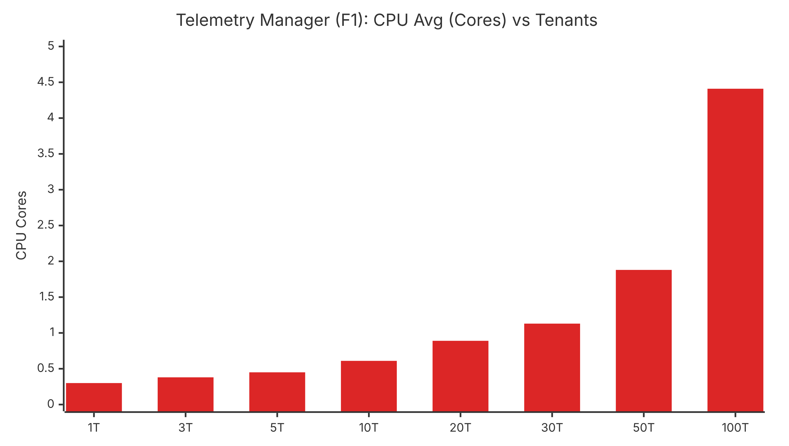
  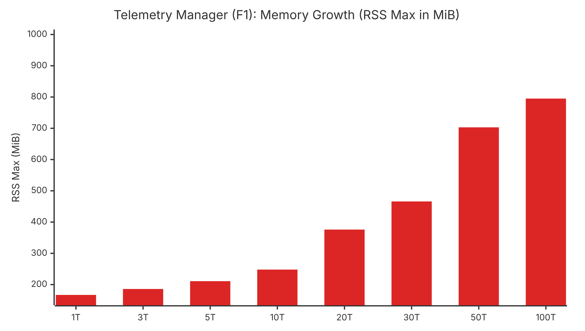

| Tenants         | 1     | 3     | 5     | 10    | 20    | 30    | 50    | 100      |
| --------------- | ----- | ----- | ----- | ----- | ----- | ----- | ----- | -------- |
| CPU avg (cores) | 0.30  | 0.38  | 0.45  | 0.61  | 0.89  | 1.13  | 1.88  | **4.41** |
| CPU p95         | 0.37  | 0.46  | 0.51  | 0.72  | 0.99  | 1.23  | 2.13  | 5.10     |
| RSS max (MiB)   | 167   | 186   | 211   | 248   | 376   | 466   | 703   | 795      |
| Delivered       | 100 % | 100 % | 100 % | 100 % | 100 % | 100 % | 100 % | 100 %    |

- The TM gateway delivers 100 % up to 100 tenants (291 pipelines, 2,365 processor instances), with no refusals or restarts.
- CPU grows faster than linearly: **4.41 cores at 100 tenants, about 7× the 0.64 cores of Routing** ([section 4](#4-fan-out-vs-routing)).
- In an earlier setup, two tiers failed: at 30 and 100 tenants the receiver refused most data (31 % and < 3 % delivered) while exporter queues were at most half full. The cause is still unknown; the `memory_limiter` is the likely suspect.

## 4. Fan-Out vs. Routing

> **OTLP only** · plain OTel Collector with TM enrichment · 25k signals/s · red = Fan-Out, green = Routing

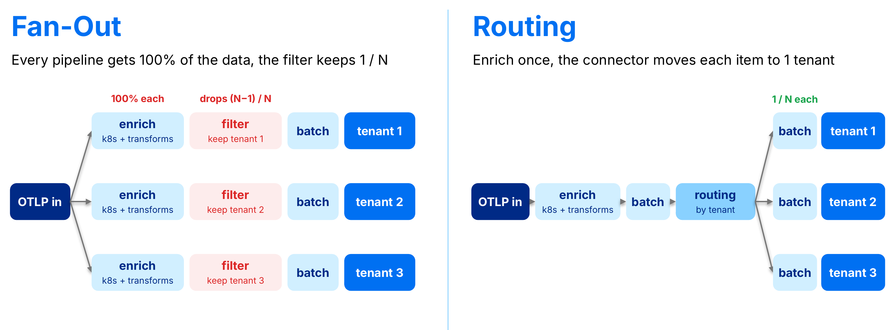

- **Fan-Out** (today's TM gateway): every pipeline gets 100 % of the data, enriches it and then filters out (N-1)/N of it. For metrics, enrichment runs once and a `forward` connector fans out.
- **Routing:** one input pipeline per signal enriches and batches once; the `routing` connector moves each item to its tenant pipeline (`batch` → exporter). No filters.

  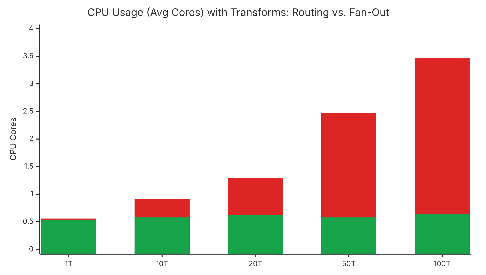
  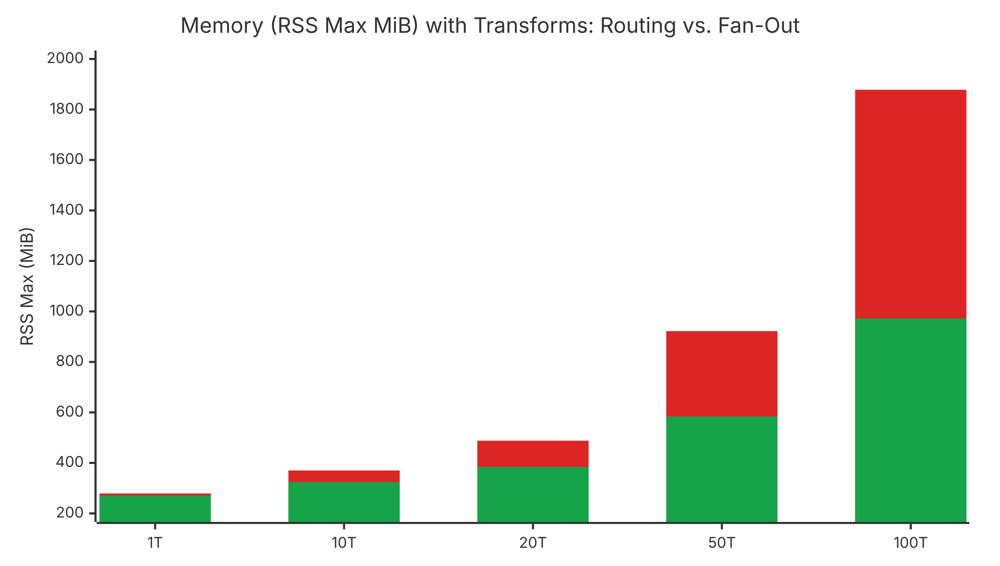

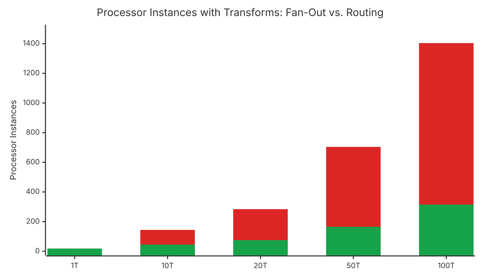

| Tenants                               | 1           | 10          | 20          | 50          | 100             |
| ------------------------------------- | ----------- | ----------- | ----------- | ----------- | --------------- |
| CPU avg Routing / Fan-Out (cores)     | 0.54 / 0.56 | 0.58 / 0.92 | 0.62 / 1.30 | 0.58 / 2.47 | **0.64 / 3.47** |
| RSS max Routing / Fan-Out (MiB)       | 271 / 279   | 324 / 370   | 384 / 488   | 584 / 922   | 972 / 1,878     |
| Processor instances Routing / Fan-Out | 18 / 18     | 45 / 144    | 75 / 284    | 165 / 704   | 315 / 1,404     |

- **Routing** stays at 0.54-0.64 cores from 1 to 100 tenants with zero drops.
- **Fan-Out** adds about 14 processor instances per tenant, whereas Routing adds only 3. At 100 tenants Fan-Out saturates the node: p95 is 3.98 cores on the 3.92-core `n1-standard-4`.

## 5. TM full stack

> **OTLP + log agent + metric agent** · gateway: 10k spans, 2k metric points, 3k logs/s · log agent: 3k lines/s · metric agent: 7k points/s · one `n4-highcpu-32` node

  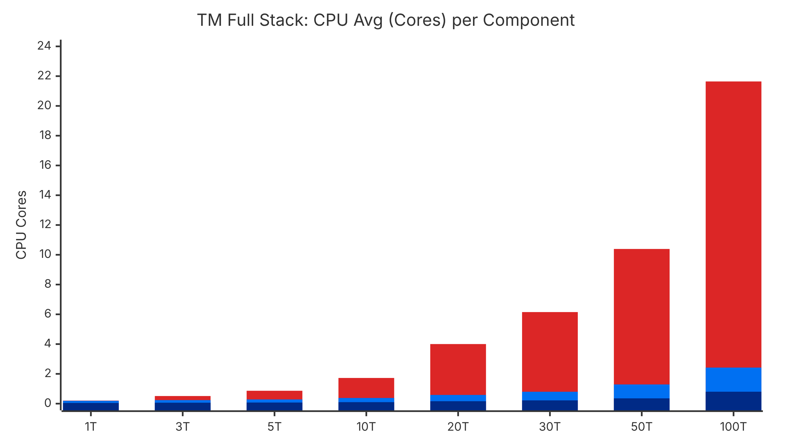
  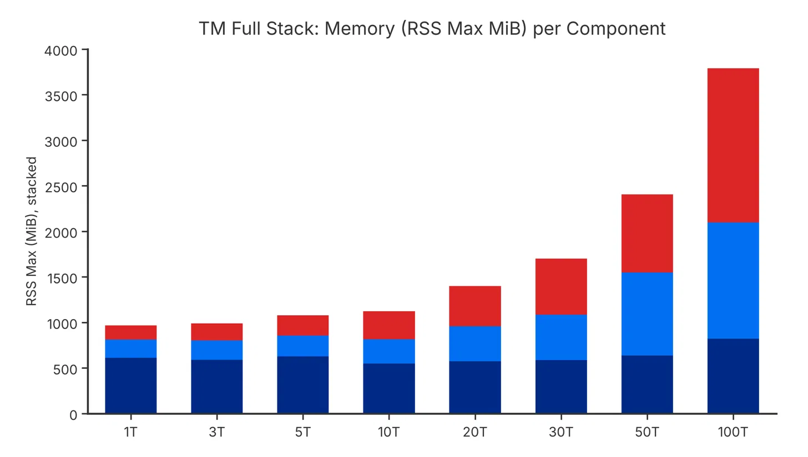

Red = log agent, blue = gateway, navy = metric agent. CPU bars overlap from zero; memory bars are stacked.

| Tenants                | 1          | 3          | 5          | 10         | 20         | 30         | 50          | 100               |
| ---------------------- | ---------- | ---------- | ---------- | ---------- | ---------- | ---------- | ----------- | ----------------- |
| Gateway CPU / RSS      | 0.19 / 200 | 0.24 / 211 | 0.28 / 228 | 0.38 / 265 | 0.59 / 383 | 0.80 / 499 | 1.29 / 914  | 2.42 / 1,278      |
| Log agent CPU / RSS    | 0.21 / 154 | 0.51 / 188 | 0.87 / 221 | 1.73 / 310 | 4.00 / 440 | 6.15 / 616 | 10.39 / 857 | **21.64** / 1,692 |
| Metric agent CPU / RSS | 0.05 / 612 | 0.06 / 590 | 0.07 / 628 | 0.10 / 549 | 0.16 / 575 | 0.22 / 586 | 0.36 / 636  | 0.80 / 821        |

CPU in cores (average), RSS max in MiB.

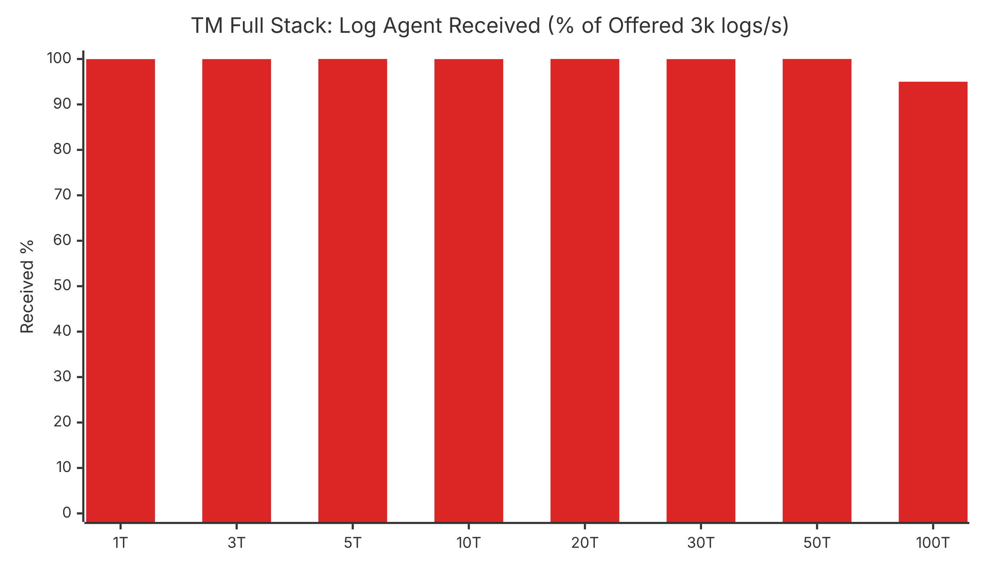

- All tiers ran with **no refusals, restarts or OOM kills**. Gateway and metric agent deliver 100 %. The log agent reads 100 % up to 50 tenants and **95 % at 100 tenants**, where the node reaches 88.5 % CPU.
- Cost per added tenant: gateway +0.02 cores and +11 MiB, metric agent +0.008 cores, **log agent +0.21 cores** and +16 MiB.
- An earlier sweep (`n4-highcpu-16`, 5k log lines/s, older TM build) ran clean to 20 tenants (log agent 7.15 cores). At 30 tenants the log agent read only 22-38 % of the lines, yet reported no refusals: the loss was silent. By then the VPA had lowered its memory limit to 473 MiB.

## 6. Log agent scalability

> **OTLP + log agent + metric agent** · same 3k lines/s at every tier

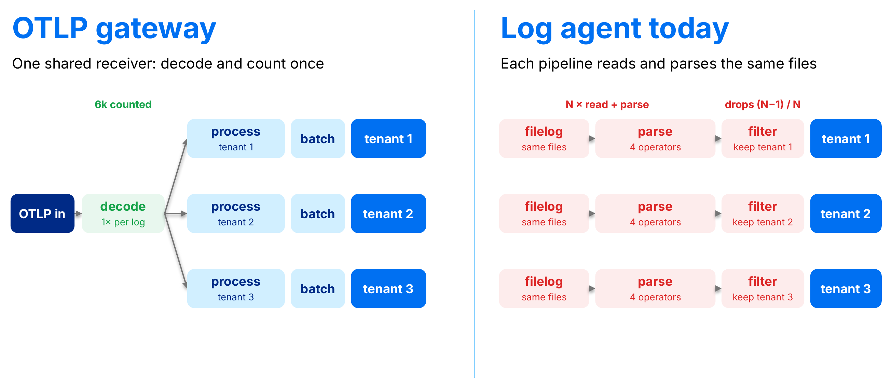

- The **OTLP gateway** has one shared receiver: each item is decoded and counted once, then copied to the pipelines.
- The **log agent** creates **one `filelog` receiver per LogPipeline**. With N pipelines it reads the same container log files N times and runs the full parse chain N times (containerd, JSON, severity, trace context) before each pipeline's filter drops (N-1)/N of the lines.
- The receiver metric counts each line once per pipeline: with 10 tenants, 6k real lines/s show up as 60k logs/s.

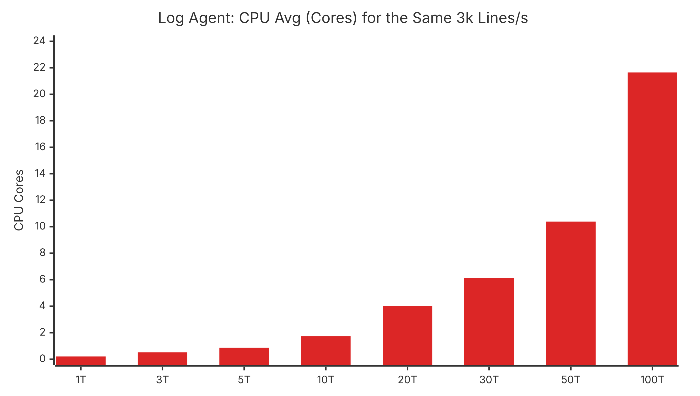

| Tenants                  | 1    | 3    | 5    | 10   | 20   | 30   | 50    | 100   |
| ------------------------ | ---- | ---- | ---- | ---- | ---- | ---- | ----- | ----- |
| Log agent CPU (cores)    | 0.21 | 0.51 | 0.87 | 1.73 | 4.00 | 6.15 | 10.39 | 21.64 |
| µs per line per pipeline | 68   | 57   | 58   | 58   | 67   | 68   | 69    | 72    |

**Cost model:** `log agent CPU ≈ 0.07 ms × log lines/s on the node × LogPipelines`. It also predicts the 5k lines/s sweep (7.2 cores expected at 20 tenants, 7.15 measured).

**Proposed fix:** one shared `filelog` receiver and parse chain, then route by tenant. Reading and parsing run once per line; only routing, processing and export run per tenant. Expected cost close to the 1-tenant cost (about 0.2 cores at 3k lines/s); not measured yet.

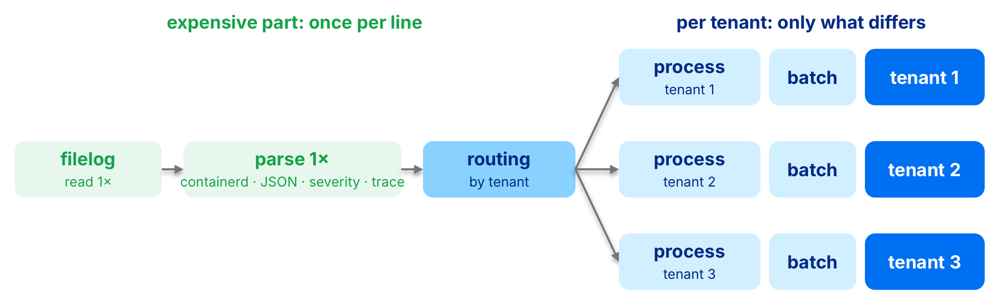

## 7. ConfigMap size

> Kubernetes limits a ConfigMap to 1 MiB (1,024 KiB). All sizes are measured from the generated configs.

  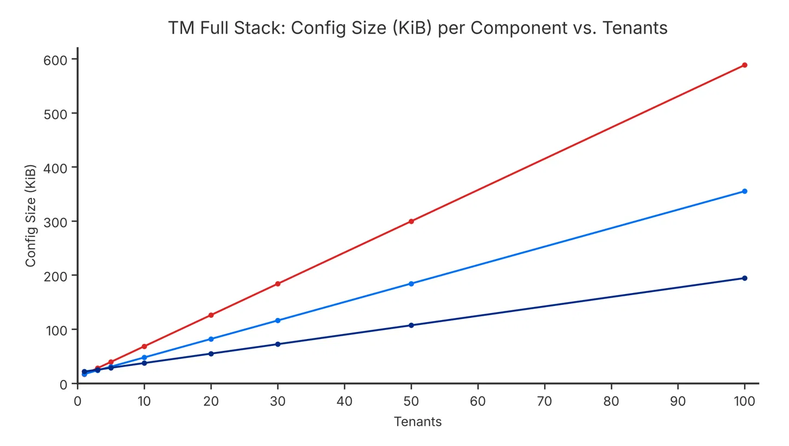
  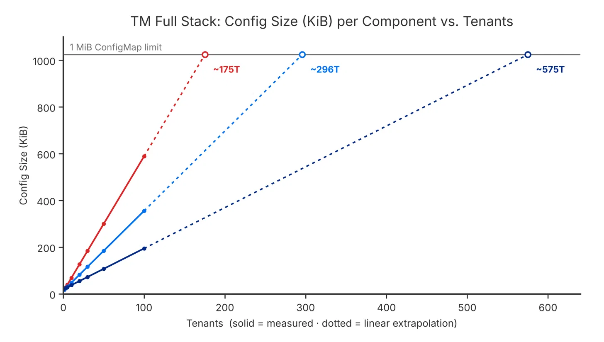

Red = log agent, blue = gateway, navy = metric agent. Right: solid = measured, dotted = linear extrapolation to 1 MiB.

| Config                                | At 100 tenants     | Per tenant | Reaches 1 MiB at |
| ------------------------------------- | ------------------ | ---------- | ---------------- |
| TM log agent                          | **589 KiB (57 %)** | 5.8 KiB    | **~175 tenants** |
| TM gateway (full stack)               | 355 KiB (35 %)     | 3.4 KiB    | ~296 tenants     |
| TM metric agent                       | 194 KiB (19 %)     | 1.75 KiB   | ~575 tenants     |
| Plain collector, Fan-Out + transforms | 226 KiB (22 %)     | 2.2 KiB    | ~461 tenants     |
| Plain collector, Routing + transforms | 193 KiB (19 %)     | 1.9 KiB    | ~545 tenants     |

- Config size grows exactly linearly with the tenant count. **No ConfigMap limit is reached at this scale.**
- Fallback if ever needed: the collector merges its config from several ConfigMaps (the load-test tool already splits configs this way), so TM can split, for example at 80 % fill.

---

## 8. Fault isolation

> **OTLP only** · pipeline `p-000` of each signal exports to a backend that returns 70 % HTTP 503 with 1 s delay

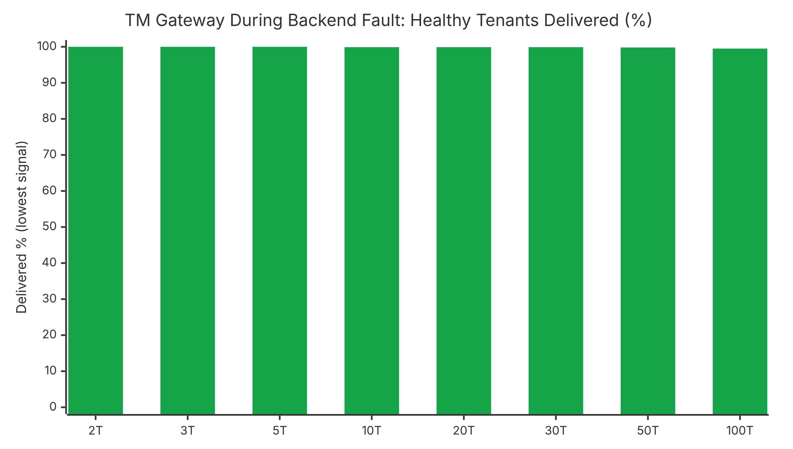

| Tenants                                           | 2     | 3     | 5     | 10     | 20     | 30     | 50     | 100    |
| ------------------------------------------------- | ----- | ----- | ----- | ------ | ------ | ------ | ------ | ------ |
| Healthy tenants delivered (lowest signal)         | 100 % | 100 % | 100 % | 99.9 % | 99.9 % | 99.9 % | 99.8 % | 99.5 % |
| Faulty tenant exported (signals/s, lowest signal) | 134   | 151   | 141   | 139    | 144    | 99     | 55     | 23     |
| Gateway CPU avg (cores)                           | 0.28  | 0.31  | 0.40  | 0.56   | 0.85   | 1.36   | 1.91   | 3.43   |
| Gateway RSS max (MiB)                             | 553   | 497   | 421   | 385    | 427    | 517    | 862    | 1,273  |

- **TM gateway:** healthy tenants keep ≥ 99.5 % delivery up to 100 tenants, with **0 send or enqueue failures** on healthy exporters. Dedicated exporter queues contain the retries.
- The faulty tenant's own throughput falls as N grows, because TM sizes each tenant's exporter queue as `max(1, 256 / tenants)` entries, so per-tenant capacity shrinks as tenants grow.
- **Plain collector** (2, 20, 50 tenants): same isolation in both shapes, 0 failures on healthy exporters. During the fault Routing stays at 0.50-0.64 cores; Fan-Out reaches 2.68 cores at 50 tenants.
- Note: for TM runs the tool cannot separate healthy from faulty exporters, so its automatic data-loss and queue flags come from the faulty pipeline only. The table above uses per-exporter values.

---

## 9. Persistent queues

A BDC request asks for file-backed (persistent) queues for OTel logs. This was not load-tested, but the deployment model decides how it would scale.

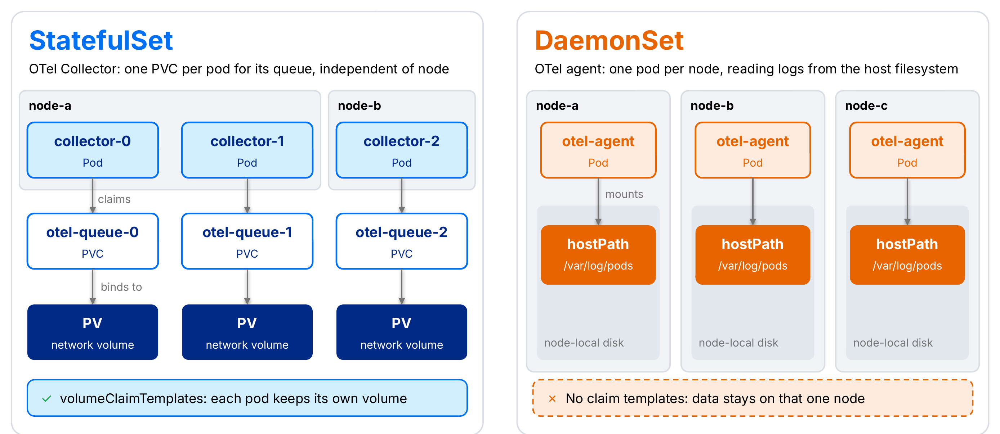

- **StatefulSet**: `volumeClaimTemplates` give each pod its own PVC. This would isolate the storage for TM, but a PVC per pod is not natively supported for DaemonSets.
- **DaemonSet**: A DaemonSet must store queues on the node-local disk (`hostPath`). A `hostPath` volume is not tracked as pod storage, so the kubelet cannot reclaim it by evicting the pod. If the queue fills the disk, the kubelet may run out of storage it needs, which can take down the node. Cap `hostPath` usage well below node capacity.
- Disk usage per pipeline should be measured before persistent log queues are enabled.

## 10. Conclusion and next steps

### Recommended limits

| Pipeline type                     | Today | Recommendation | With routing |
| --------------------------------- | ----- | -------------- | ------------ |
| **TracePipeline, MetricPipeline** | 5     | **20**         | > 100        |
| **LogPipeline**                   | 5     | **10**         | > 100        |

- **20 trace, OTLP log and metric pipelines:** every OTLP scenario ran clean at 20 tenants, including the TM gateway on an `n4-highcpu-16` node (0.89 cores).
- **10 Runtime LogPipelines:** the log agent costs about 70 µs CPU per log line and pipeline, on every node. 10 pipelines at 1,500 lines/s per node are about 1 core.
- **> 100 with routing:** measured on the plain collector up to 100 tenants (0.64 cores, zero drops), the largest tier tested; how far beyond 100 it scales is still open. Routing must be re-tested inside TM before this is promised.

### Unknowns and risks

| Found during testing                                                                                                                               | Not covered yet                                                                |
| -------------------------------------------------------------------------------------------------------------------------------------------------- | ------------------------------------------------------------------------------ |
| Log agent with runtime input cost = pipelines × log rate, on every node                                                                            | Disk usage of persistent queues per pipeline                                   |
| Silent log loss: the log agent fell behind, i.e. not exporting logs, without marking that in metrics or error messages                             | Many failing backends at once (queue memory × N); no OOM threshold was reached |
| The VPA adjusts memory limits, but the `memory_limiter` keeps the limit set at pod start and ignores the change                                     | Routing inside TM (all routing numbers are from the plain collector)           |
| TM gateway refusals on a small node at 30+ tenants, cause open #TODO: not helpfull, not enough context                                             | TM reconcile and collector rollout with many pipelines                         |
| Readiness lags for config: at 100 tenants 294 of 303 pipelines were in the otel config when TM reported them generated                             | Load per tenant (fixed rate per tenant), single signal types, repeated runs    |

### Next steps

1. **Raise the limit:** TracePipeline and MetricPipeline 5 → 20, LogPipeline 5 → 10.
2. **Fix queue sizing:** decouple the exporter queue size from the pipeline count; confirm the cause of the gateway refusals.
3. **Routing in TM:** enrich once plus routing connector in the gateway; one shared `filelog` receiver plus routing in the log agent.
4. **Close the gaps:** persistent queues, many failing backends, routing re-tested in TM, repeated runs.
